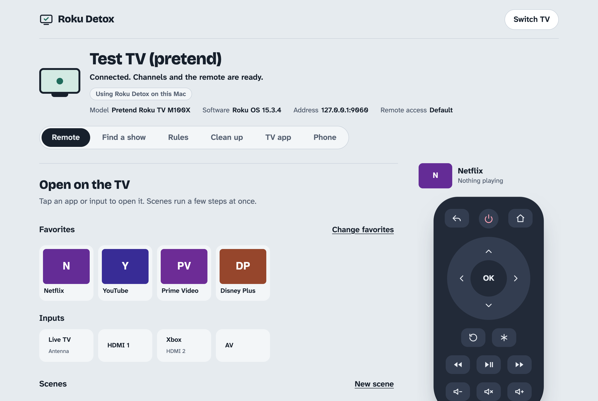
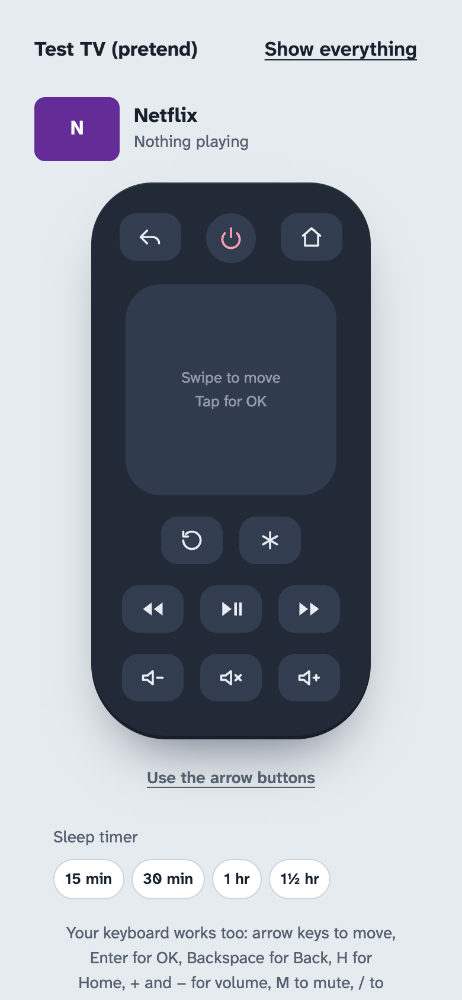
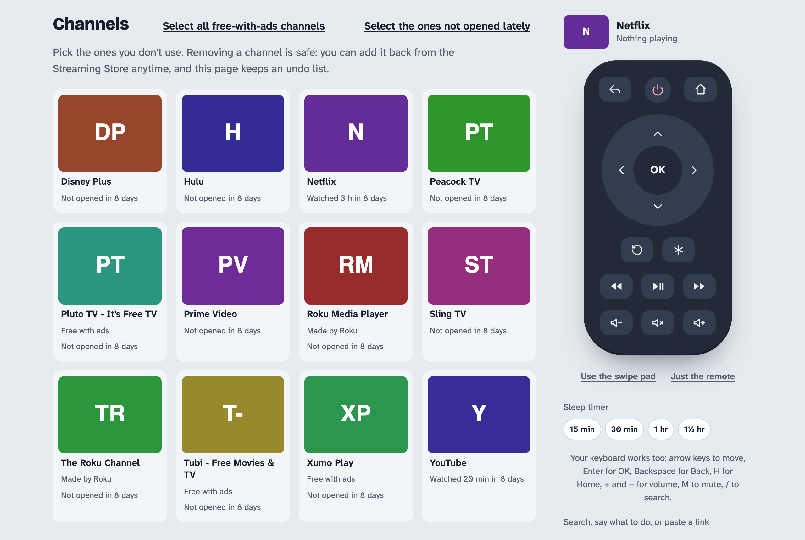

# Roku Detox

Find a Roku TV on your Wi-Fi and clean it up from a web page on your computer.

<p>
  
  
</p>
<p></p>

(Screenshots use the pretend TV in `mock_roku.py`.)

## Quick start

1. On the TV: Settings > System > Advanced system settings > Control by mobile apps > Network access >
   **Default** (set it back to Limited when you're done).
2. Either run the program, `python3 roku_detox.py` (Python 3, nothing to install; the page opens at
   http://127.0.0.1:8642), or load `extension/` in Chrome (chrome://extensions > Developer mode >
   Load unpacked) and click its toolbar button.
3. The page finds the TV. If it doesn't, type the TV's address (on the TV: Settings > Network > About).

Then try: tap an app, hold Volume up, press `/` and type "open Netflix", set a sleep timer. With the
extension: type `tv pause` in Chrome's address bar, or right-click a video and pick "Play this video on the TV".

## Ways to control it

| From | How |
| --- | --- |
| The page | Tap apps, inputs, scenes and the on-screen remote; type a phrase or a link in the box under it. |
| The keyboard | Arrows, Enter, Backspace; `1`–`9` open favorites; `/` jumps to the search box; `?` lists every key. |
| A phone | Open the page over home Wi-Fi (Phone menu; program), or "Just the remote" for a full-screen remote. The extension's phone relay works too. |
| Siri and Shortcuts | "pause", "open Netflix", "what's on", "time left", "15 more minutes" (Phone menu > Siri and Shortcuts; program). |
| The iPhone share sheet | Share a YouTube or Netflix link to a shortcut and it plays on the TV (program). |
| Home-screen buttons | Links like `#do=open%20Netflix` that do one thing after a 2-second pause (Phone menu; program). |
| Chrome's address bar | `tv` then a space: `tv netflix`, `tv pause`, `tv what's on`, `tv the bear` (extension). |
| Right-click | "Play this video on the TV" on videos, "Send this link to the TV" on links (extension). |
| The toolbar popup | A small remote, what's on, time left, the sleep timer, and a phrase box (extension). |
| Keyboard shortcuts anywhere in Chrome | Play/pause, send this tab's video, volume (extension; change them in chrome://extensions/shortcuts). |

## What's in it

The page has six menus:

- **Remote**: open any app or input, favorites, scenes, the on-screen remote (arrow buttons or a
  swipe pad), voice search on secure pages, and a sleep timer (15 minutes to 1½ hours) that turns the
  TV off even after you close the page, while this program or the extension is running. Hold an arrow
  or volume button to repeat it. If the TV is off and not answering, the page explains Fast TV start, and
  the program can try to wake it (Wake-on-LAN, using the network address it saw while the TV was on).
- **Find a show**: search any show or movie, see which of your apps has it, and start it on the TV.
  Listings come from JustWatch's public catalog (unofficial, so it may change). Roku can see which apps
  are installed but not which ones you pay for, so you can untick services under "My services". Recent searches
  stay under the box (in this browser only) to run again with one tap.
  **My sites** searches video sites you add (paste any results page address, like
  `https://www.youtube.com/results?search_query=cats`). Results are read from the page's links and from
  the data many sites tuck inside the page (YouTube, schema.org, Next.js), so no scripts or ads load.
  For sites that only show results after their scripts run, the extension's **Look closer** opens the
  page in a hidden, muted tab for a few seconds, reads it and closes it, and remembers to do that for the site.
  YouTube results open in the YouTube app; other videos play in Detox Home.
  Detox Home can search them on the TV too, with no computer on (it plays sites' plain video files; not YouTube or DRM).
- **Rules**: things that run in the background while the program is open on your Mac:
  skip the home screen when the TV turns on, bedtime (every night, school nights, or the nights you pick), daily time limits
  (per app, or for all TV together, with a different amount on weekends if you like), blocked apps, swap apps,
  night guard (turns the TV back off when it wakes itself up at night), and a viewing log.
  It checks the TV every 4 seconds and keeps the Mac from sleeping (`caffeinate`) while any rule is on.
  Alerts show as macOS notifications. "Pause all rules" turns them off for an hour, three hours or until
  morning (viewing time still counts), then they come back on by themselves. Includes a connection check with plain-language fixes, and
  screen time for the past days (total, daily average, a bar for each day, top apps, how the past week compares with the one before, and a spreadsheet download). Apps with a daily
  limit show the time left today on the Remote menu and in the extension's popup, and an upcoming bedtime
  shows there within the hour.
- **Clean up**: remove channels, finish-up checklist, undo list, and "Move your settings" (save
  favorites, scenes, rules and sites to a file and load them in the extension or on another computer). With the viewing log on, each channel
  shows how long it was watched, and after a week "Select the ones not opened lately" picks the unused ones.
- **TV app**: install **Detox Home**, a custom Roku app (in `roku-app/`): a calm home screen with a clock
  and your apps and favorites, rule notices ("Time's up"), messages you send from the Mac or phone, videos from
  web links, and an ad-free "Detox Clock" screensaver. Needs Roku developer mode (Home x3, Up x2,
  Right, Left, Right, Left, Right on the remote); you type the developer password on the page, and it's
  sent only to the TV and never saved. The clock, messages and videos need nothing else running. Roku OS 12
  and later don't let apps on the TV open other apps (Roku's ECP docs: "Support for sending ECP commands
  from within a Roku app has been discontinued"), so on those TVs its app tiles stay empty; open apps from
  the Roku home screen or with Roku Detox.
  Press * on the remote on a tile to add or remove a favorite; favorites and options chosen on the page
  are sent to it while it's open.
- **Phone**: use your phone as the remote. With the phone remote on, "Set up a shortcut" makes a key
  for Apple's Shortcuts app (or anything that can send a web request): POST `{"do": "pause"}` to
  `http://<this Mac>:8642/api/do` with the header `X-Detox-Key`. Phrases: pause, home, back, louder,
  quieter, mute, on, off, volume up 5, open Netflix, HDMI 2, one of your scene names, sleep 30,
  cancel sleep, pause rules, resume rules, 15 more minutes (extra time today), search The Bear; anything else searches the TV. The answer is a sentence Siri can read out,
  and you can ask too: "what's on" (Netflix is on, playing, 12 minutes in), "screen time" (today's total and the top app,
  from the viewing log) and "time left" (what's left on each daily limit, and when bedtime is). With a household PIN set,
  "pause rules" needs it too. With the key, a YouTube or Netflix link as `do` plays it on the TV, so a shortcut
  shown in the iPhone share sheet sends those links straight to the TV. (`#do=` links never play links.)
  The Phone menu also lists **home-screen buttons**: links like `http://<this Mac>:8642/#do=open%20Netflix`
  that open the page and do that on the TV after a 2-second pause you can cancel. Add them to a phone's
  home screen for one-tap Netflix, a scene, or "sleep 30".

**Send a video link to the TV**: paste a link into the box under the remote, or use the "Send to TV"
bookmark from the TV app menu. YouTube and Netflix links open in their own apps. For other pages the Mac
looks for the video file (direct links, `<video>` tags, page metadata) and plays it in Detox Home. If
[yt-dlp](https://github.com/yt-dlp/yt-dlp) is installed it's used for sites the built-in finder can't read.
Videos locked by DRM (Netflix, Disney+ and most paid services) can't be sent this way. Links sent from a phone
or another device can't point at addresses on your home network (only links typed on this computer can).
Through the extension's phone relay, a phone sends YouTube and Netflix links or direct links to video files;
the browser doesn't open other pages for it.

- Finds Roku TVs on the network automatically, or connect by IP address.
- Shows every channel with its icon, labeled: free-with-ads, made by Roku, or part of the TV (inputs).
- Removes the channels you pick, one at a time. The page opens each channel's store page on the TV,
  you confirm "Remove channel" with the on-screen remote (or your real one), and the page checks it's gone.
- Keeps an undo list (`undo-list.json`). "Add back" reopens the store page so you can re-add a channel.
- On-screen remote, with keyboard shortcuts.
- Shortcuts: one-tap buttons for your favorite apps and every HDMI input, plus scenes
  (several steps in a row, like "turn on, switch to the Nintendo Switch, volume down 5", or "show 'Time for
  bed' on the TV, volume down 5, turn off in 45 minutes").
  A scene can also run every day at a set time, while this program is running.
- Now playing: which app is on, playing or paused, and how far in.
- One box for searching across all apps (opens Roku's search screen and types for you), pasting a
  YouTube or Netflix link to play it on the TV, or typing into a sign-in field on the TV. It also acts on
  clear commands, typed or spoken: "open Netflix", "watch YouTube", "HDMI 2", "sleep 30", or an app or scene's
  exact name. Anything else, even a show called "Home" or "It", is a search. "Live typing" sends each letter to
  the TV as you type, for sign-in and search boxes on the TV. Links you send are listed under the box to send again.
- Phone remote: open the page on your phone over home Wi-Fi. A phone needs a one-time
  6-digit code from the Mac page. Shortcuts, scenes, rules and paired phones are kept in `remote-settings.json`;
  rule activity in `activity-log.json` and the viewing log in `viewing-log.json`.
- A finish-up checklist for the settings Roku only lets you change on the TV itself,
  plus a Restart button that waits for the TV to come back and confirms it started normally.

Not made by Roku. Nothing here touches Roku's system software: removed channels can always be
added back from the Streaming Store.

## Run it

Needs Python 3 (already on most Macs). No installs.

```bash
python3 roku_detox.py
```

Your browser opens http://127.0.0.1:8642. Keep the terminal window open while you use it.

The first time, macOS may ask whether Terminal can find devices on your local network. Choose
Allow, or the page won't be able to reach the TV.

## Ways to run it

The same page works three ways (see `ENGINE.md` for the details):

- **On a phone or any browser, as a plain link** ("lite"): sends commands straight to the TV, which covers
  remote buttons, your apps, inputs, scenes and starting episodes. It can't read the TV, so rules and Find a show need one of the others.
- **With the browser extension** (`extension/`, load it in Chrome): everything, inside the browser.
  Rules run while the browser is open. It also offers "Send to TV" for videos you play and blocks ads while you browse.
- **With this program on an always-on computer**: everything, all the time, for the whole household.
  - Raspberry Pi or Linux: `sudo sh deploy/install-pi.sh`
  - NAS or any Docker host: `docker compose -f deploy/docker-compose.yml up -d`
  - This Mac at login: `sh deploy/install-mac.sh` (undo with `sh deploy/install-mac.sh remove`)

  With `--household`, anyone on your Wi-Fi can open `http://<computer name>.local:8642` with no pairing.
  Add `--pin 1234` so changing rules, the TV app or sites from other devices needs that PIN (the page asks for it
  once per tab; a shortcut sends it in an `X-Detox-Pin` header). Use `--data FOLDER`
  to keep settings and logs somewhere else.

### Install Detox Home with no computer

From a phone (or any browser on the home Wi-Fi):

1. On the TV, turn on developer mode: Home 3 times, Up 2 times, Right, Left, Right, Left, Right; choose
   "Enable installer and restart" and pick a password.
2. Download [detox-home.zip](https://github.com/fabioelia/roku-detox/releases/download/detox-home/detox-home.zip)
   (built from `roku-app/` by `.github/workflows/detox-home.yml` on every change; it carries no settings).
3. Open `http://<TV address>` (on the TV: Settings > Network > About), sign in as `rokudev` with that password,
   choose the file and press Install. Installing again updates it.

The lite page's TV app menu walks through the same steps. With the program or the extension, the TV app menu
does it for you: type the developer password and press Install (or Update). Or build the file yourself:
`python3 roku_detox.py --export-tv-app detox-home.zip`.

### Home Assistant and other automations

Anything that can send a web request can use the same phrases as Siri: turn on the phone remote, choose
"Set up a shortcut" on the Phone menu for a key, then POST `{"do": "<phrase>"}` to `http://<this computer>:8642/api/do`
with the header `X-Detox-Key: <key>` (and `X-Detox-Pin` too for rule phrases, if a household PIN is set). The answer
is `{"done": "<a sentence>"}`. For example, in Home Assistant's `configuration.yaml`:

```yaml
rest_command:
  roku_detox:
    url: "http://192.168.1.10:8642/api/do"
    method: post
    headers:
      X-Detox-Key: !secret roku_detox_key
    content_type: "application/json"
    payload: '{"do": "{{ phrase }}"}'
```

Then call it from an automation with `phrase: "sleep 30"`, `"pause rules"`, `"open Netflix"` or `"what's on"`.

## Let the page use your TV

Roku TVs block other devices by default. On the TV:
Settings > System > Advanced system settings > Control by mobile apps > Network access > **Default**
(some versions say **Enabled**).

While that's on, any device on your Wi-Fi can control the TV. When you're done, set it back to
**Limited**. It's the last step on the page's checklist.

## What it can't do

Roku doesn't allow these from another device, so the page walks you through them instead:
privacy and ad-tracking settings, the home screen, sleep timer, and screensaver. Roku also doesn't
report free memory and has no animation setting.

## Try it without a TV

`mock_roku.py` is a pretend Roku for testing:

```bash
python3 mock_roku.py
```

Then enter `127.0.0.1:9060` as the TV address. Add `--limited` to see what a locked-down TV looks like.

To check the page itself in a real browser (headless Chrome, a pretend TV and a throwaway copy of the
program; your settings and TV aren't touched):

```bash
node tools/ui-smoke.mjs
```

The extension has its own tests: see `extension/README.md`.

What changed lately: `CHANGELOG.md`.
